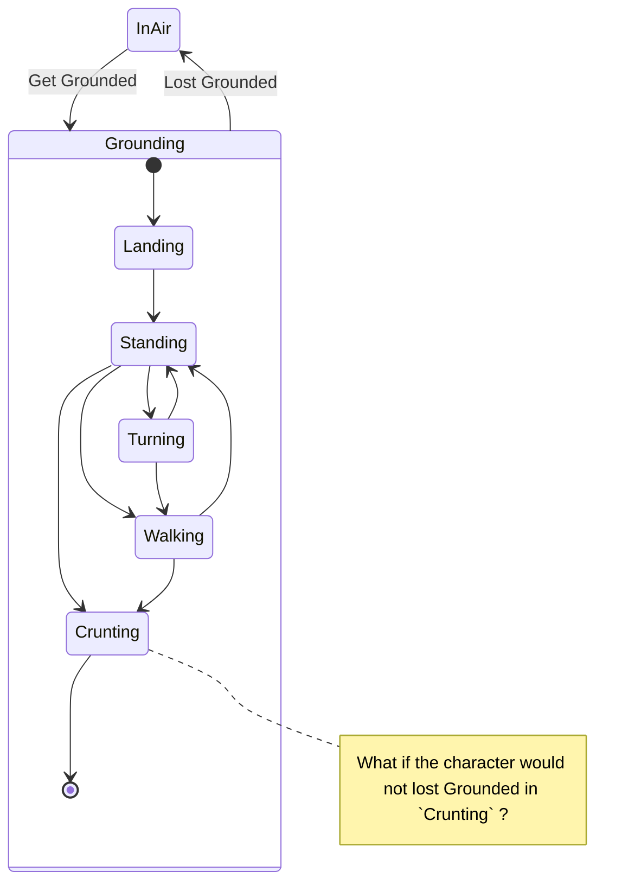

## For the Next

### New Design: Separate Action Capability Modules

#### Capability components

Character Controller is a state machine that has an animation graph module and add/remove some capability components.
A Capability component represent its Entity has the capability now: `JumpCapable`, `RcWalkCapable`, ... `XxxCapable`.

e.g. "Jump":

1. A Character controller inserts a `JumpCapable` when its state has jump capability.
2. When a player intended to make the character jumping, `JumpCapable` chatches it and emits a jump intended event.
3. The Character controller receives the event, and then it issues a playing crunting animation request to the animation graph.
4. The animation graph emits a take-off event when the crunting animation clip reatched at a pre-defined point.
5. The character controller receives the event, and then it issues a jump request to the `JumpCapable`.
6. The `JumpCapable` adds an upper force to the Entity.


### Trun & Walk

Next: Add turn & walk



### Controller & Graph connector

- [ ] Transforms of Collider and ShapeCaster for the ground should be specfied in Gltf extensions or our asset file having Gltf path & animation graph (or graph file path).
- [ ] description for Graph events -> Controller commands & Controller events -> Graph commands

### Controller

- [x] Any CharacterController actions that must be emitted from an animation graph should
  be defined within the graph itself.
  e.g. "crunting" clip node: When the animation reaches a jumping timing,
       the graph emits "JumpImpulse" action
  - Now, graph description has `events` for it.
    ashiojin_extensions's system for it emits `EntityEvent` having `String` event names when `clipnode` reaches the timing defined by `time`.


### Graph

- [ ] Binding infomation from CharacterController events to AnimationGraph commands
  likes "If it lands heavily, play 'landing-heave' node and set the node's weight
  to 1.0, and some other nodes's weights to 0.0".
  - [x] Graph commends now can be defined in a graph description.
     But all properties of these commands are not variable, for now.
  - [ ] Add arguments to commands and make commands description can be accepted to reference them.
  - [ ] simple calculation in commands description
- [ ] Loading state cheker required.

#### Graph commands

description:
```json
{
    "name": "an action",
    [
        { "Play": {
            "target_node": "clipnode4action", "repeat": false, "speed": 1.0
        }}
    ]
}
```

kick :
```rust
commands.entity(e).queue(AnimationGraphCommandRequest("an action")); // it start "clipnode4action"'s clip animation
```

#### Add arguments to graph commands

description:
```json
{
  "name": "an action",
  "list": [
    { "SetWeight": {
      "target_node": "blendnode_for_xxx",
      "weight": { "ArgF32": { "name" : "arg_name" } }
    }}
  ]
}
```

kick :
```rust
let args = HashMap::new();
args.insert("arg_name", 0.5);
commands.entity(e).queue(AnimationGraphCommandRequest("an action", args));
```

#### Simpel calculation in commands description

```json
{
  "name": "an action",
  "list": [
    { "SetWeight": {
      "target_node": "blendnode_for_xxx",
      "weight": {
        "CalcPlus" : {
          "left": { "ArgF32": { "name" : "arg_name" } },
          "right": { "ConstF32": { "value": 0.2 } }
        }
      }
    }}
  ]
}
```


